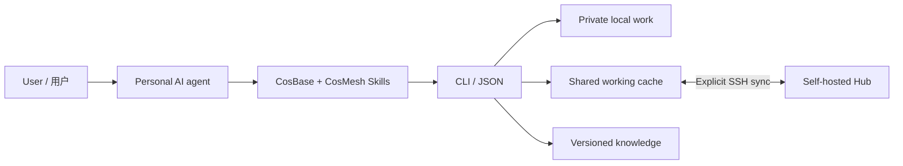

# Architecture / 系统架构

**Thread** is a unit of work with a stable ID. Its overview and append-only records carry context, notes, requests, results, citations, and lifecycle changes. Session and directory bindings are private execution metadata. Views and backlinks are rebuilt from versioned sources.

Thread 是一件工作的持续记录，跨会话接续。概况与追加记录保存事实和来源，状态、列表与回链由源文档重建；本机执行定位保持私人。

**CosBase and CosMesh share storage primitives and CLI contracts.** Base is private and offline-capable. Mesh is readable by authenticated users on one Hub, with authorship and request permissions checked on writes. Sharing and synchronization are explicit.

两套系统共用文档、版本、存储和查询能力，隐私范围由工作所在位置决定。共享读取、业务动作权限和原作者归属分别表达。

**Knowledge is versioned independently.** Uploaded documents retain their originals and extracted text. Work records pin their sources; reverse links reveal the work and results that used each version.

知识库保管独立资料版本，工作记录引用实际依据；沿回链可找到使用过资料的 Thread 与具体成果。

## Source map / 源码导航

| Files | Responsibility / 职责 |
|---|---|
| `cli.py`, `thread_cli.py`, `community_cli.py` | Commands and stable JSON / 命令与回执 |
| `threads.py`, `thread_protocol.py`, `thread_lifecycle.py` | Work, citations and lifecycle / 工作、引用与生命周期 |
| `store.py`, `sync.py`, `connections.py` | Git snapshots, locks and transport / 存储、锁与传输 |
| `hub.py`, `gateway.py`, `access.py` | Controlled writes and verified system identity / 受控入口与身份 |
| `knowledge.py`, `knowledge_protocol.py`, `community.py` | Knowledge, users and shared archives / 知识、用户与档案 |
| `search.py`, `legacy_search.py` | Bounded retrieval, including legacy sources / 有界检索与旧库只读接入 |
| `profile.py`, `field_crypto.py`, `feedback.py`, `guide.py` | Private preferences, optional field encryption, support / 私人资料与系统支持 |
| `skills/`, `manual/`, `resources/` | Portable agent guidance and packaged resources / Skill、说明与安装资源 |
| `service.py`, `protocol.py` | Earlier Project/Task/Update workspaces / 旧版三种文档兼容 |

The program enforces IDs, versions, authorship, append-only history and synchronization rules. Your agent interprets intent and evidence. Coordination runs through personal Agents and ordinary requests.

程序执行确定性规则，个人 Agent 负责理解与判断。日常协作由个人 Agent 通过普通请求按需完成。

Hub access reuses existing SSH and the server's verified operating-system account. Client applications, Hub data, release packages and personal workspaces have separate locations. A self-hosted deployment supplies its own paths and connection configuration.

An optional maintenance entry points to an ordinary published Thread. The Hub owner can inspect it with `cosmesh hub maintenance --hub-root HUB`, set it with `--repo REPO --thread THREAD_ID`, or remove the entry with `--clear`. Thread discovery returns its current source, title and maintainer; clients cache the reference during discovery and refresh. The reference lives in deployment configuration. It creates no Thread, request or separate feedback store. An unavailable entry does not block ordinary space discovery.

可选维护入口指向一个普通、已发布的工作串。维护者用上述命令登记引用，客户端通过发现与刷新取得当前来源、标题及维护者；入口存于 Hub 部署配置。此步骤只提供入口发现，请求仍沿用普通 Thread 机制。

Users submit `thread request --maintenance --body TEXT --sync`; the recipient defaults to the registered Thread creator. Replies, assignment, result delivery and requester adoption use ordinary Thread commands. Original feedback history and pending queues remain available through the legacy `feedback` commands. The retired experimental Mesh Agent is removed; personal Agents perform coordination.

用户用 `thread request --maintenance --body 内容 --sync` 提交普通请求，默认接收人为维护 Thread 创建者。回应、分配、交付和采用复用 Thread 命令。旧反馈历史与待发送队列保留兼容；公共 Mesh Agent 实验组件已移除，协调由个人 Agent 完成。

Prepared local pages (`thread page --ready --json`) provide a single overview table, saved short names and introductions, progress and private agent-project/workspace associations. `--continue ID_OR_NAME` appends selected status in the same call. Markdown/SQLite derivatives are rebuildable; source records and privacy boundaries remain authoritative. Fast mode is on by default; `client mode normal` turns it off, `client mode fast` restores it. Per-call `--no-fast`/`--fast` does not change the saved preference.

`thread create --title TEXT --english TEXT --chinese TEXT --intro TEXT` saves names with the new work; `thread name ID` updates them through ordinary creator-authored records. Old aliases remain searchable, names can be ambiguous and IDs stay stable. Existing work is not renamed in bulk. `thread bind-project` stores private Codex/DSH/OpenCode project or workspace links independently of sessions; `--kind directory` explicitly represents a directory workspace when no native project exists. Explicit project onboarding directly creates or reuses suitable private work; sharing still follows the user's authorization.

Thread sharing defaults to a text brief and leaves associated files local. Only after explicit user authorization, attach selected supporting documents: `thread share ID --attach FILE --sync` (repeat `--attach`), or use a private `--materials` selection. Existing documents can be reused through fixed `cosmesh://library/K-ID@VERSION/FILENAME` references. `library open REFERENCE` verifies and materializes the file locally; `--launch` explicitly opens the system viewer. Data/archive suffixes are skipped by default, with 20 MiB per file and 100 MiB per share. Incomplete materials remain visible as partial. Pin code through `--git HTTPS_URL --commit FULL_COMMIT`; private originals, execution bindings, historical versions and unrelated knowledge drafts stay preserved. See `guide show sharing` for the bounded workflow and retry behavior.
