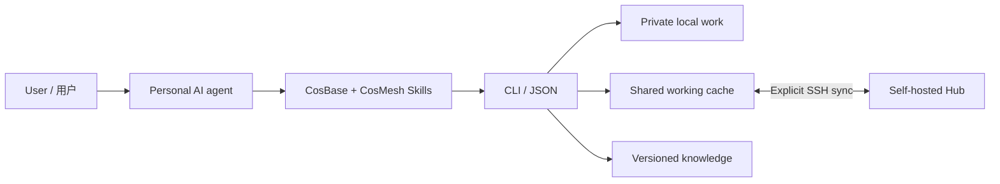

# Architecture / 系统架构

**Thread** is a unit of work with a stable ID. Its overview and append-only records carry context, notes, requests, results, citations, and lifecycle changes. Session and directory bindings are private execution metadata. Views and backlinks are rebuilt from versioned sources.

Thread 是一件工作的持续记录，跨会话接续。概况与追加记录保存事实和来源，状态、列表与回链由源文档重建；本机执行定位保持私人。

**CosBase and CosMesh share storage primitives and CLI contracts.** Base is private and offline-capable. Mesh is readable by authenticated users on one Hub, with authorship and request permissions checked on writes. Sharing and synchronization are explicit.

两套系统共用文档、版本、存储和查询能力，隐私范围由工作所在位置决定。共享读取、业务动作权限和原作者归属分别表达。

**Knowledge is versioned independently.** Uploaded documents retain their originals and extracted text. Work records pin their sources; reverse links reveal the work and results that used each version.

知识库保管独立资料版本，工作记录引用实际依据；沿回链可找到使用过资料的 Thread 与具体成果。

## Source map / 源码导航

| Files | Responsibility / 职责 |
|---|---|
| `cli.py`, `thread_cli.py`, `community_cli.py` | Commands and stable JSON / 命令与回执 |
| `threads.py`, `thread_protocol.py`, `thread_lifecycle.py` | Work, citations and lifecycle / 工作、引用与生命周期 |
| `store.py`, `sync.py`, `connections.py` | Git snapshots, locks and transport / 存储、锁与传输 |
| `hub.py`, `gateway.py`, `access.py` | Controlled writes and verified system identity / 受控入口与身份 |
| `knowledge.py`, `knowledge_protocol.py`, `community.py` | Knowledge, users and shared archives / 知识、用户与档案 |
| `search.py`, `legacy_search.py` | Bounded retrieval, including legacy sources / 有界检索与旧库只读接入 |
| `profile.py`, `field_crypto.py`, `feedback.py`, `guide.py` | Private preferences, optional field encryption, support / 私人资料与系统支持 |
| `skills/`, `manual/`, `resources/` | Portable agent guidance and packaged resources / Skill、说明与安装资源 |
| `service.py`, `protocol.py` | Earlier Project/Task/Update workspaces / 旧版三种文档兼容 |

The program enforces IDs, versions, authorship, append-only history and synchronization rules. Your agent interprets intent and evidence. Normal operation requires no embedded model service; the optional Mesh Agent is experimental and disabled by default.

程序执行确定性规则，个人 Agent 负责理解与判断。日常协作按需进行；可选公共 Mesh Agent 为实验组件，默认关闭。

Hub access reuses existing SSH and the server's verified operating-system account. Client applications, Hub data, release packages and personal workspaces have separate locations. A self-hosted deployment supplies its own paths and connection configuration.
